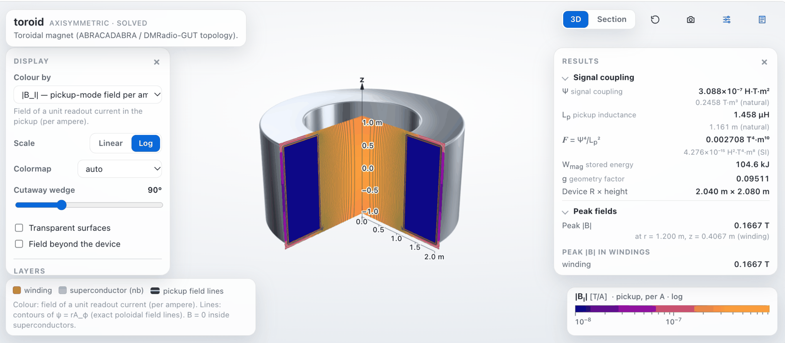
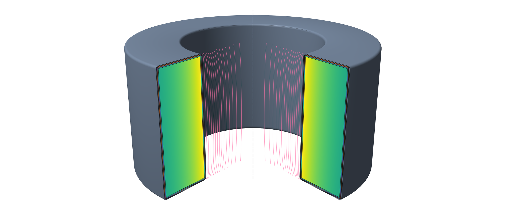
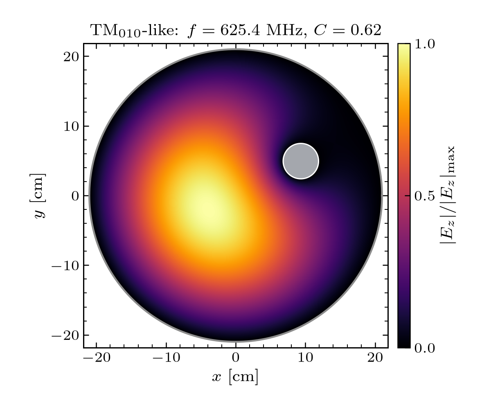
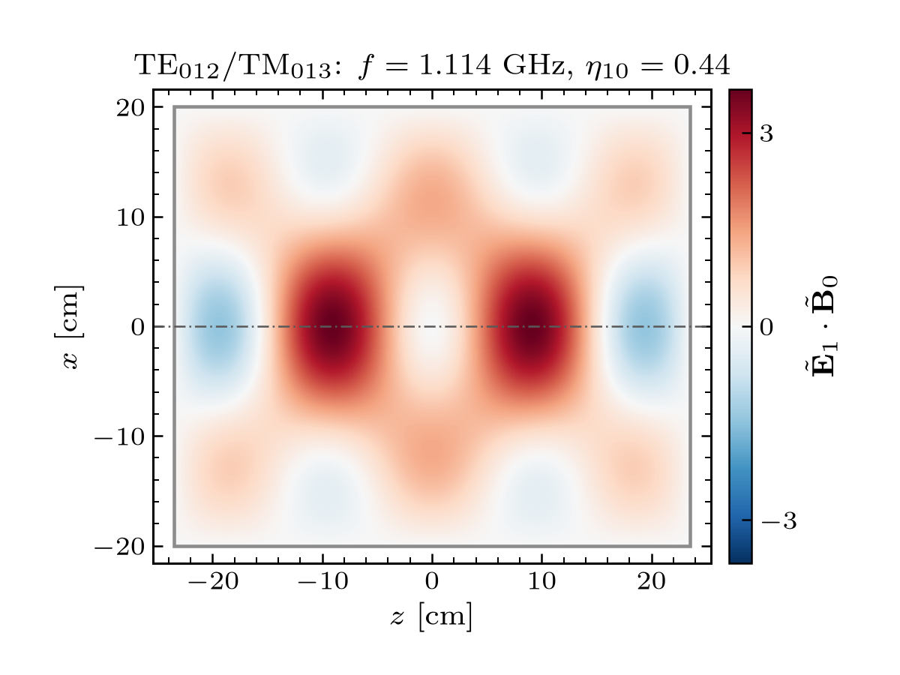
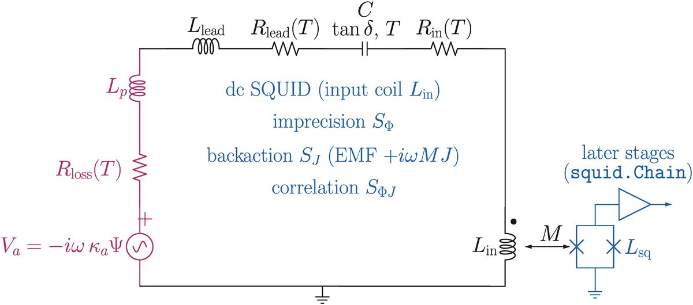
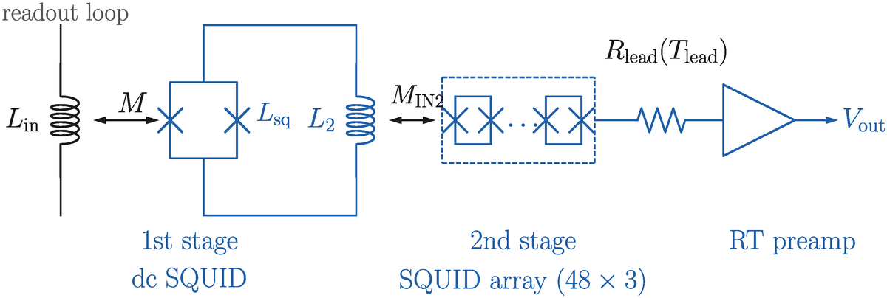

# axionMultiPhysics

[](https://doi.org/10.5281/zenodo.24298305)

axionMultiPhysics is a finite-element package for electromagnetics, structural
mechanics, heat conduction, fluid flow and electrochemistry. We built it to
design axion dark-matter detectors: lumped-element experiments (e.g.,
ABRACADABRA, DMRadio, CORE), resonant-cavity haloscopes (e.g., ADMX, HAYSTAC,
CAPP, QUAX, ORGAN) and superconducting radio-frequency heterodyne cavities.
The solvers themselves are general and apply to magnets, superconducting
devices, RF structures and resonators in other settings. It has a C++ core
built on MFEM, a Python interface, a 3D viewer, and an MCP server so that
designs can be built and evaluated through chat.

**What it solves:** magnetostatics and magnetoquasistatics (superconducting,
resistive and iron-core magnets and shields; fields, inductances, forces);
full-wave electromagnetics (impedances, S-parameters, radiation, eigenmodes);
superconductors (flux constraints, critical surfaces, the HTS critical state);
electrostatics; circuits with the noise of every element; mechanics and heat
conduction; adjoint shape sensitivities and optimization; and, in beta,
incompressible flow and electrochemistry. Geometries are axisymmetric profiles
or 3D solids, including imported CAD (STEP). Axisymmetric problems run on one
machine; 3D problems use MPI.

**New in 0.2.0, all in beta:**

- *Model documents:* one physics-based input format for fluids, heat,
  electrochemistry and coupled physics, with a physics catalogue, validation,
  `axmp explain`, `axmp patch` and a JSON Schema
  ([design format](https://github.com/bsafdi/axionMultiPhysics/blob/main/docs/design_format.md#model-documents-beta)).
  Planar and axisymmetric documents are meshed with named boundaries
  (`axmp boundaries`, `axmp mesh`; [meshes of model documents](https://github.com/bsafdi/axionMultiPhysics/blob/main/docs/guides/model_meshes.md)),
  and the meshes can be handed to the fluids and chemistry engines; solving a
  model document is not available yet.
- *Export to Geant4:* field maps of solved designs
  ([field maps](https://github.com/bsafdi/axionMultiPhysics/blob/main/docs/guides/field_maps.md)) and solids and GDML of axisymmetric and 3D
  designs ([solids and GDML](https://github.com/bsafdi/axionMultiPhysics/blob/main/docs/guides/solids.md)), checked in Geant4 by
  `axmp-transport --geometry`.
- *Particle transport:* `axmp-transport`, a separate Geant4 program built on
  request, driven from Python by `axionmultiphysics.particles` (reproducible
  runs, estimates with statistical errors)
  ([particle transport](https://github.com/bsafdi/axionMultiPhysics/blob/main/docs/guides/particles.md),
  [validation](https://github.com/bsafdi/axionMultiPhysics/blob/main/docs/validation/particles.md)).
- *Fluids:* every sparse direct solve is accepted on its caller's own accuracy
  gate through a recorded retry chain (`lu_retry`, `lu_stage`, `lu_attempts`).

**Documentation:** [bsafdi.github.io/axionMultiPhysics](https://bsafdi.github.io/axionMultiPhysics/) (installation, tutorials, API reference)



*The interactive viewer (`res.show()` in a notebook, or `res.export_html(...)` for a standalone page)
on the quick-start ABRACADABRA-style toroid (R = 2 m, H = 2 m): a 90° cutaway colored by the
pickup-mode field per ampere $`|\mathbf B_I|`$ (log scale), with the pickup field lines and the results panel
(signal coupling $`\Psi`$, pickup inductance $`L_p`$, $`\mathcal F=\Psi^4/L_p^2`$, stored energy, peak fields).*

<details>
<summary>Static field $`\mathbf B_\mathrm{lab}`$ of the same toroid (3D cutaway)</summary>

<picture>
  <source media="(prefers-color-scheme: dark)" srcset="https://raw.githubusercontent.com/bsafdi/axionMultiPhysics/main/docs/images/home/hero_toroid_dark.png">
  
</picture>

*The toroidal lumped-element detector of the quick start (R = H = 2.0 m, NI = 1.0 × 10⁶ A turns), solved axisymmetrically and drawn by axionMultiPhysics's renderer as a 3D cutaway. Colour: the static field |B| on the cut planes (viridis, 0 to 0.167 T), which is confined to the toroid volume; where it vanishes the planes are left uncoloured. Pink: field lines of the pickup mode in the bore. Signal coupling Ψ = 3.088 × 10⁻⁷ H T m², pickup inductance L_p = 1.458 µH, with third-order elements; second-order elements agree to 4 × 10⁻⁶.*
The figure is generated by [docs/images/make_homepage_figures.py](https://github.com/bsafdi/axionMultiPhysics/blob/main/docs/images/make_homepage_figures.py).

</details>



*Transverse cross-section with an off-centre tuning rod (ADMX cavity, R = 210 mm, one 50.8 mm rod; pivot geometry
inferred): $`|E_z|`$ of the $`\mathrm{TM}_{010}`$-like mode from the cross-section eigensolver (`"symmetry": "xsec"`,
beta), with $`f`$ and the form factor $`C`$ ([script](https://github.com/bsafdi/axionMultiPhysics/blob/main/docs/images/make_readme_panels.py)); $`f`$ and $`C`$ agree with an
independent method-of-particular-solutions calculation to about 1e-8 ([validation](https://github.com/bsafdi/axionMultiPhysics/blob/main/docs/validation/cavity_xsec.md)).*



*SRF heterodyne cavity (beta): the 60 L closed cylinder of Lasenby (arXiv:1912.11056), R = 20 cm, at the length where
the $`\mathrm{TE}_{012}`$ pump and the $`\mathrm{TM}_{013}`$ signal are degenerate: their overlap density
$`\tilde{\mathbf E}_1\cdot\tilde{\mathbf B}_0`$ on the meridional section (fields in units of their rms values), whose
volume average is the overlap factor $`\eta_{10}`$, from the axisymmetric eigensolver with `axionmultiphysics.srf`; the
closed form of the cylinder pair agrees to 1e-5
([docs/srf/](https://github.com/bsafdi/axionMultiPhysics/blob/main/docs/srf/README.md),
[script](https://github.com/bsafdi/axionMultiPhysics/blob/main/docs/images/make_readme_panels.py)).*




*Left: the readout loop of `circuit.series_readout` ([docs/physics/readout_circuit.md](https://github.com/bsafdi/axionMultiPhysics/blob/main/docs/physics/readout_circuit.md)),
drawn by the package itself: `readout.draw(annotate=False)` (with values: `readout.draw()`; also `Chain.draw()`,
`MultiportReadout.draw()`; the `draw` extra). Right: the dc SQUID amplifier chain behind the input coil (beta),
`squid.chain("C1+low+RT").draw(annotate=False)` ([docs/physics/squid_chain.md](https://github.com/bsafdi/axionMultiPhysics/blob/main/docs/physics/squid_chain.md)). Typeset
by [docs/images/make_readme_panels.py](https://github.com/bsafdi/axionMultiPhysics/blob/main/docs/images/make_readme_panels.py); the plain SVG versions come from
[docs/images/make_circuit_figure.py](https://github.com/bsafdi/axionMultiPhysics/blob/main/docs/images/make_circuit_figure.py).*

> Status: version 0.2.0 (alpha). Axisymmetric and MPI 3D solvers, full-wave analysis, circuits, HTS, mechanics and
> heat conduction, and the design tools are checked against closed-form solutions, manufactured solutions,
> independent solvers or published results ([validation](https://github.com/bsafdi/axionMultiPhysics/blob/main/docs/validation/index.md)). Beta (working and tested, but
> with an interface or a validation that is not complete): cavity haloscopes, SRF heterodyne cavities, dc SQUID
> chains, multi-band and multipole scans, torsional dynamics, the COMSOL import, the fluids, scalar-transport and
> chemistry modules, the surface-resistance models, model documents, the export to Geant4 and particle transport,
> and in 3D full wave everything except current ports (prescribed sources, the imposed background field, perfectly
> matched layers, the error indicator, the Gauss-law guard, the adaptive sweep, the tree-cotree solve, eigenmodes,
> closed RF-only models and the energy-matrix, field-export and reactive-load diagnostics). The 3D engine and the
> fluids module need the MPI source build; particle transport needs a Geant4 installation and a source build with
> `-DAXMP_BUILD_TRANSPORT=ON`.

## What it computes for lumped-element detectors

For a lumped-element detector geometry (windings, superconductors, iron, normal conductors,
readout port) axionMultiPhysics solves the magnetoquasistatic problems that define a
lumped-element axion search:

- the static laboratory field $`\mathbf B_\mathrm{lab}`$ (nonlinear iron, superconductors with
  frozen fluxoid or prescribed current, exact open boundary);
- the pickup mode: the field of a unit readout current, giving $`L_p`$;
- the signal coupling $`\Psi=\frac{1}{I}\int \mathbf A_I\cdot\mathbf B_\mathrm{lab}\,d^3x`$ ($`\Phi_a=\kappa_a\Psi`$);
- the scan figure of merit $`\mathcal F=\Psi^4/L_p^2`$ against the requirement $`\mathcal F_\mathrm{req}`$ of
  the optimal resonant scan (Chaudhuri et al.), for any noise benchmark;
- stored energy, peak fields in windings and on superconducting surfaces,
  Lorentz forces and Maxwell pressure, cold-envelope area and a cost metric (a scaling metric for comparing
  designs, not a construction estimate);
- **shape sensitivities** of all of those with respect to the design parameters
  (adjoint on a morphed mesh) and gradient-based optimization
  ([docs/optimization.md](https://github.com/bsafdi/axionMultiPhysics/blob/main/docs/optimization.md)).

## Quick start

The 0.2.0 wheels follow on PyPI after the release. Until `pip index versions axionmultiphysics` lists 0.2.0,
`pip install axionmultiphysics` installs 0.1.0, whose API lacks the 0.2.0 features, and we install 0.2.0 from source
([installation](https://github.com/bsafdi/axionMultiPhysics/blob/main/docs/guides/install.md#build-and-installation)).
Once the wheels are listed, we install the wheel from PyPI with meshing and notebook support. The wheels are planned for
Linux x86_64 and macOS (x86_64 and arm64), CPython 3.10–3.14; 0.2.0 itself was built and tested on Linux x86_64 only:

```bash
pip install "axionmultiphysics[mesh,notebook]"
```

On Linux, gmsh's wheel (the `mesh` extra) needs a few X11/OpenGL libraries even without a display (Debian/Ubuntu:
`sudo apt-get install libglu1-mesa libgl1 libxcursor1 libxft2 libxinerama1`). Other platforms build from source
([installation](https://github.com/bsafdi/axionMultiPhysics/blob/main/docs/guides/install.md)).

We solve the quick-start toroid to inspect its summary and fields, then export an HTML view.

```python
import axionmultiphysics as axmp
res = axmp.template("toroid", R=2.0, H=2.0, y=0.6).solve()
print(res.summary())
res.show()                      # the 3D viewer in a Jupyter cell
res.export_html("toroid.html")  # or a self-contained page
```

The wheels have everything except the 3D engine and the fluids module, which need MPI and so the
[MPI source build](https://github.com/bsafdi/axionMultiPhysics/blob/main/docs/guides/install.md#mpi-source-build). `axmp.build_info()` reports the available build features.

Step-by-step [example notebooks](https://github.com/bsafdi/axionMultiPhysics/tree/main/examples/) (executed, and rendered on the documentation website) cover
lumped-element detectors, SQUID readout chains, cavity haloscopes, SRF heterodyne cavities, mechanics and heat,
fluids and chemistry.

With the MPI source build (on a cluster, in a compute allocation), we build the dependencies and axionMultiPhysics to
solve an example design.

```bash
bash scripts/fetch_deps.sh && bash scripts/build_deps.sh
cmake -S . -B build -G Ninja -DCMAKE_BUILD_TYPE=Release && cmake --build build
./build/axmp solve examples/long_solenoid_coax.json -o runs/demo
```

`axmp validate design.json` checks a design and prints actionable errors;
`axmp schema` prints the JSON Schema of the design format;
`axmp requirement` prints $`\mathcal F_\mathrm{req}`$ for the benchmarks.

## Layout

| Path | Contents |
|---|---|
| `cpp/` | C++ library `libaxionmultiphysics`, CLI `axmp`, mesher `axmp-mesher` (gmsh, separate process), particle transport `axmp-transport` (Geant4, separate process, built on request; beta) |
| `python/axionmultiphysics` | Python package: builder API, templates, viewer server, MCP server |
| `viewer/` | three.js viewer shipped with the package |
| `docs/` | [installation](https://github.com/bsafdi/axionMultiPhysics/blob/main/docs/guides/install.md), [build options](https://github.com/bsafdi/axionMultiPhysics/blob/main/docs/install.md), [viewer](https://github.com/bsafdi/axionMultiPhysics/blob/main/docs/viewer.md), [COMSOL export](https://github.com/bsafdi/axionMultiPhysics/blob/main/docs/comsol_export.md), [COMSOL import](https://github.com/bsafdi/axionMultiPhysics/blob/main/docs/comsol_import.md) (`axmp import-comsol model.mph`, beta), [particle transport](https://github.com/bsafdi/axionMultiPhysics/blob/main/docs/guides/particles.md) (beta), physics notes, design-format reference, [validation](https://github.com/bsafdi/axionMultiPhysics/blob/main/docs/validation/index.md) |
| `benchmarks/` | validation cases and their records (e.g. [SRF cell](https://github.com/bsafdi/axionMultiPhysics/tree/main/benchmarks/srf/): 2D/3D convergence) |
| `examples/` | example designs and notebooks: [quick start](https://github.com/bsafdi/axionMultiPhysics/blob/main/examples/notebook_quickstart.ipynb), [lumped-element detectors](https://github.com/bsafdi/axionMultiPhysics/blob/main/examples/lumped_element_demo.ipynb) (toroid, solenoid, CORE: geometry → $`\Psi`$, $`L_p`$ → $`\mathcal F`$ vs $`\mathcal F_\mathrm{req}`$ → scan), [mechanics and thermal](https://github.com/bsafdi/axionMultiPhysics/blob/main/examples/mechanics_thermal_demo.ipynb) (forces on the winding, support stresses, cooldown, heat load with $`k(T)`$), [dc SQUID amplifier chains](https://github.com/bsafdi/axionMultiPhysics/blob/main/examples/squid_chain_demo.ipynb) (beta), [cavity haloscope walkthrough](https://github.com/bsafdi/axionMultiPhysics/blob/main/examples/cavity_demo.ipynb) (beta; geometry → eigenmodes → $`C`$, $`Q_0`$ → reach), [SRF heterodyne cavities](https://github.com/bsafdi/axionMultiPhysics/blob/main/examples/srf_demo.ipynb) (beta; mode pair → $`\eta_{10}`$, $`G`$, $`\xi`$ → required volume), [fluids](https://github.com/bsafdi/axionMultiPhysics/blob/main/examples/fluids_demo.ipynb) (beta; Stokes flow), [chemistry](https://github.com/bsafdi/axionMultiPhysics/blob/main/examples/chemistry_demo.ipynb) (beta; current distributions) |

## Building the docs

The documentation website (MkDocs Material; user guides from `docs/`, the
example notebooks, and an API reference generated from the docstrings) builds
without the compiled core.

We install the documentation dependencies and run the preview, strict build and offline build to generate the site.

```bash
pip install -r docs/requirements.txt -c docs/constraints.txt
mkdocs serve                        # live preview on http://127.0.0.1:8000
mkdocs build --strict               # what CI checks (.github/workflows/docs.yml)
bash scripts/docs/build_offline.sh  # a site/ that opens from disk (file://; MathJax still needs a network)
```

The API reference lists the public objects in `docs/api.md`; the validation pages, physics notes and other
reference pages are kept out of the site by `exclude_docs` in `mkdocs.yml` and linked on GitHub.

## Citing

We ask that work using axionMultiPhysics cite

> J. N. Benabou, J. W. Foster, B. R. Safdi, *The Price of Discovery: Cost-Optimized Detectors for the GUT-Scale QCD Axion*, [arXiv:2611.23374](https://arxiv.org/abs/2611.23374) [hep-ph] (2026).

and the software itself (DOI [10.5281/zenodo.24298305](https://doi.org/10.5281/zenodo.24298305)), using the metadata in [CITATION.cff](https://github.com/bsafdi/axionMultiPhysics/blob/main/CITATION.cff). Please also cite the methods and
benchmark papers your work relies on, and MFEM. [About](https://github.com/bsafdi/axionMultiPhysics/blob/main/docs/about.md#citing-axionmultiphysics) has a BibTeX entry.

## Development

axionMultiPhysics was developed by its authors with Claude (Anthropic) as an AI coding agent in Claude Code, mostly
Claude Opus 5.5; most commits in its development history carry a Claude Opus 5.5 co-author trailer. The correctness of
axionMultiPhysics rests on its checks, not on how the code was written: each validated capability is checked against
closed-form solutions, manufactured solutions, independent solvers or published results, most of those checks run in the
test suite, and modules with less validation evidence are labelled beta. Contributions are welcome; the
[developer guide](https://github.com/bsafdi/axionMultiPhysics/blob/main/docs/developer/contributing.md) and
[AGENTS.md](https://github.com/bsafdi/axionMultiPhysics/blob/main/AGENTS.md) describe the conventions.

## Authors

Joshua N. Benabou, Joshua W. Foster, Benjamin R. Safdi

## License

BSD 3-Clause ([LICENSE](https://github.com/bsafdi/axionMultiPhysics/blob/main/LICENSE)). The vendored three.js (`viewer/vendor/`, MIT) and stb_image_write
(`cpp/third_party/`, MIT or public domain) keep their own licences. gmsh (GPL) is used only as an external program, is
not redistributed in our wheels, and comes from its own PyPI package. Geant4 (whose builds contain the LGPL-3 CLHEP)
is linked only by `axmp-transport`, a separate program built from source on request, and is in no wheel; licensing details are in
[docs/install.md](https://github.com/bsafdi/axionMultiPhysics/blob/main/docs/install.md#licensing-of-each-wheel), "Licensing of each wheel".

## Trademarks

COMSOL and COMSOL Multiphysics are registered trademarks of COMSOL AB. axionMultiPhysics is not affiliated with, sponsored by or endorsed by COMSOL AB. Other product names are trademarks of their owners.
